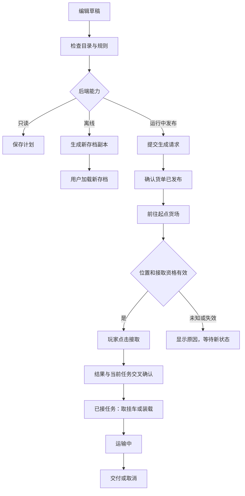

> 历史研究材料。版本与“本轮”描述对应当时调查，不代表当前实现。当前仅维护 overlay；见 [货运指南](FREIGHT-COPY.md)与[提交反馈调查](FREIGHT-FEEDBACK.md)。

# 货运功能面板：深入研究与开发设计

本文保留较早阶段记录，之后的公开接入调查见 [接口要求](FREIGHT-INTEGRATION-OPTIONS.md)。用户随后要求对照已安装面板进行静态研究并实现；当前 0.2.10 的可选本地适配见 [自选做货与任务复制](FREIGHT-COPY.md)。历史调查的范围描述不代表该本地构建只使用公开接口。

研究日期：2026-11-03。基线：已安装的 Truck Companion Overlay 0.2.1。本文是设计与源码调查，以下新增能力均未实施。

## 1. 结论

**完整货运面板可以继续开发；在 TruckersMP 当前会话里自选生成并现场接取，仍缺少已确认的稳定操作接口。**

这次找到了一份真正调用游戏内部函数的运行中生成/接取实现，因此不能把“公开 SDK 没有接口”说成“技术上做不到”。但该实现只支持特定 ETS2 版本，主动拒绝 TMP，不能安装过来就解决当前需求，也不能通过删掉它的 TMP 检测来证明兼容。

补充用户提供的 Seven 欧卡教程网文章后，还确认了一个**面向 TMP 的产品案例**：TruckersMP 中文面板的说明与更新日志提到实时货运目录、生成与接受任务。该产品明确披露部分功能使用未公开内部函数、需要随客户端更新适配。它使“研究 TMP 内部货运桥接”成为更直接的方向；但产品说明不能替代源码、接口合同或本机运行证据。详见 2.4。

建议把开发拆为三个模块：任务信息与记录、目录与路线草稿、生成与接取适配器。前两个可以使用遥测和文件数据推进；第三个必须明确选择正式接口、需要读档的存档方式，或单独维护的游戏内部适配。三者的按钮、状态和承诺不能混在一起。

用户要求的“到货场直接接取”以**不重新读档、由本面板发起、当前会话确认成功**为最终目标。下面的“读档后到货场接货”是备选方案，不算完成这个目标。

## 2. 新找到的实现证据

### 2.1 Trucky：成熟调度器，但仍须读档

[官方调度器指南](https://truckyapp.com/kb/dispatcher-guide/)（页面标注更新于 2026-08-30）明确要求：

> Finally, press Update Game Save and reload your save! Don't forget this step!

- 货运市场：修改存档 → 读档 → 在货运市场找到货单 → 开到起点公司绿色标记 → 接取并挂上挂车。
- 自有挂车货物市场：读档时任务已经分配，再到起点公司装货；不是修改后直接在原会话接取。
- 货运市场可离线生成多单；自有挂车市场只支持单单，且要求 Trucky 已连接运行中的游戏。
- “公司派单”及分享 ID 是另一层：可以先保存到 Trucky 服务供其他用户导入，不代表对应货单已进入玩家游戏。

[官方 FAQ](https://truckyapp.com/kb/dispatcher-faq-common-issues/)（更新于 2025-10-16）进一步说明：

- 自有挂车市场需要读取游戏内存以构造任务；同时仍走修改存档和读档流程。
- 公司/城市可能残留在存档中，即使对应地图内容已卸载。
- 挂车不合法可能触发经济重置；路线距离不足时可能使用不准确的距离，导致报价失真。
- 不提供 Special Transport 和 World of Trucks 货单生成。

因此，“使用第三方成熟调度器”不等于“获得不读档的稳定货运 API”。其现有流程可借鉴，不能把产品功能直接视为我们可以调用的接口。

另检查了 [Trucky Public API 文档](https://api.truckyapp.com/docs/)加载的 `api_data.js`：可见城市、DLC、地图和其他查询端点，没有发现创建或接取游戏货单的公开操作。[VTC Hub 集成说明](https://truckyapp.com/kb/vtc-hub-api-and-external-drivers-hub-integration/)中的 `job_created` 是任务开始的通知，不能反向用来创建游戏任务。本轮没有申请 Token、调用私有接口或上传玩家资料。

### 2.2 TS-SE-Tool：可以追踪到的存档写入流程

项目：[LIPtoH/TS-SE-Tool](https://github.com/LIPtoH/TS-SE-Tool)，README 声明支持自定义 Freight Market 和基础 Cargo Market 编辑。调查其 `master` 源码：

| 代码入口 | 行为 |
| --- | --- |
| [FormMethodsFreightMarketTab.cs.cs，AddCargo](https://github.com/LIPtoH/TS-SE-Tool/blob/master/TS%20SE%20Tool/Forms/MainTabs/FormMethodsFreightMarketTab.cs.cs#L1443) | 从城市、公司、货物、挂车、紧急程度等选项构造 JobAdded；计算过期时间；按起点公司分组 |
| [DataManipulation.cs，PrepareCompaniesJobWrite](https://github.com/LIPtoH/TS-SE-Tool/blob/master/TS%20SE%20Tool/DataManipulation.cs#L899) | 取公司现有 `job_offer` 条目，写目标公司、过期时间、距离、货物、挂车变体、挂车定义和数量 |
| [DataManipulation.cs，PrepareEvents](https://github.com/LIPtoH/TS-SE-Tool/blob/master/TS%20SE%20Tool/DataManipulation.cs#L947) | 同步对应的经济事件过期时间，说明不能只改一条货单文本 |
| [MethodsReadWrite.cs](https://github.com/LIPtoH/TS-SE-Tool/blob/master/TS%20SE%20Tool/MethodsReadWrite.cs#L939) | 检查源文件是否在读取后变化，然后序列化写入 `game.sii` |

这证明存档生成需要维护对象引用和经济事件关系，并非给货场列表随意追加一行。该工具的写回原槽方式不适合直接移植到本项目；若做离线版，应沿用本机已有的**复制到新存档槽**流程。

本机 `ETS2Trainer/cpp/src/savecopy.cpp:402` 的 `copySlotToNewSave()` 已有源槽归属复核、写入前复核和游戏运行保护；它在游戏运行时拒绝复制。因此不能把此函数接到游戏内按钮上，就宣传为现场生成/接取。此处已重新阅读当前源码，不仅依赖历史记录。

### 2.3 Job Dispatcher SP：运行中操作存在，但不是 TMP 即插即用方案

项目：[noteMASTER11/ETS2-JobDispatcher-Plugin](https://github.com/noteMASTER11/ETS2-JobDispatcher-Plugin)。其 README 将 0.2 限定为 **ETS2 1.61.1.9、Windows x64、DX11、单人游戏**，公司提供挂车；自有挂车任务尚不支持。

本次只保存和阅读公开源码文本，没有执行其安装、构建、校验或插件程序。

| 源码证据 | 含义 |
| --- | --- |
| [dispatch.cpp:268](https://github.com/noteMASTER11/ETS2-JobDispatcher-Plugin/blob/main/src/dispatch.cpp#L268) | 请求检查发现 `core_ets2mp.dll` 即拒绝，明确只支持单机 |
| [dispatch.cpp:279](https://github.com/noteMASTER11/ETS2-JobDispatcher-Plugin/blob/main/src/dispatch.cpp#L279) | 立即接受时检查已有任务、驾驶状态、速度和已连接挂车 |
| [dispatch.cpp:337](https://github.com/noteMASTER11/ETS2-JobDispatcher-Plugin/blob/main/src/dispatch.cpp#L337) | 查找起点公司挂车停车位、保留货单槽位，处理旧条目的所有权 |
| [dispatch.cpp:361](https://github.com/noteMASTER11/ETS2-JobDispatcher-Plugin/blob/main/src/dispatch.cpp#L361) | 调用游戏内部对象构造和字符串函数，填充货单和引用 |
| [dispatch.cpp:390](https://github.com/noteMASTER11/ETS2-JobDispatcher-Plugin/blob/main/src/dispatch.cpp#L390) | 分为只发布公司货单、立即接受两种分支；立即接受使用内部函数并读取当前任务确认 |
| [dispatch.cpp:599](https://github.com/noteMASTER11/ETS2-JobDispatcher-Plugin/blob/main/src/dispatch.cpp#L599) | 启用条件同时包含非 TMP、指定可执行文件构建及代码识别条件 |

有价值的设计是：生成和接受分离、世界代次检查、停车位管理、失败恢复、用实际任务状态确认结果。**不能照搬的部分**是固定游戏对象布局和内部调用位置；也不能把 VirtualQuery 能读取某个地址视为该对象一定仍有效。

该实现的“立即接受”把挂车留在起点公司，并不等于必须已经到场；检查片段也不能证明实现了用户要求的可靠“已在货场”判定。我们的到场交互还需要单独设计。

### 2.4 用户提供的 TMP 中文面板：产品案例与证据边界

2026-11-03 阅读用户给出的 [TruckersMP Tools 重大更新介绍](https://ets2.seventmp.cn/post/438)，并跟进文中链接的[新增功能说明](https://ets2.seventmp.cn/post/473)和[更新日志](https://ets2.seventmp.cn/post/462)。来源为 Seven 欧卡教程网的产品介绍与维护记录，不是 TruckersMP 官方 SDK 合同。

已确认的页面信息：

- 主文与功能说明列出中文做货页面，并明确说明部分功能依赖未公开内部函数，需要按 TMP 版本维护。
- 2026-09-27 的记录提到挂车预览；2026-10-12 的记录提到实时城市、货场、货物、挂车目录，以及目录刷新时保留输入和选择，并阻止在路线尚不可用时生成。
- 2026-10-21 的记录提到交付或读档后恢复接受任务，并新增生成失败与耗时日志。
- 所读取日志列出 2026-10-22 适配 TMP 0.7.9.0、2026-10-25 适配 0.7.9.1。这说明按版本适配是其维护方式；不能据此宣布该版本仍是今天最新版或适配本机客户端。

它支持的判断是：**TMP 环境中存在维护中的第三方中文货运交互产品，不应把讨论只停留在单机参考代码上。** 应当继续区分“调用现有货运能力”和“独立实现游戏经济对象操作”，前者可能比从头实现后者更贴近当前目标。

它还不能证明的事项：

1. 没有从这三篇文章取得源码、公开调用接口或可授权集成的开发包，不能确认它究竟复用原版控件、使用自绘控件桥接原版业务，还是另有实现。
2. “读档后可再次接取”的修复描述是生命周期线索，既不能推导每次做货必须读档，也不能单凭它保证无需读档。
3. 尚未从文章确认当前货场识别、到场接取的距离/挂车条件，或自有挂车与所有服务器的支持范围。
4. 页面宣传里的官方功能描述不等于已获得本项目可使用的公开 API 或官方单独批准。

对我们方案的具体调整：保留独立自绘界面，在执行层增加一个**候选的 TMP 货运桥接适配器**设计。它若能获得有文档的接口，优先按合同接入；若只能依赖内部函数，则需要独立版本支持、生命周期分析、失败停用与维护范围，不能把固定入口改成特征扫描后就称为自动兼容。目录、路线、生成、接受应分别报告能力，避免一个功能失效使整个面板无法显示。

建议后续优先核实：实时目录的来源、路线就绪信号、生成/接受结果、交付/读档后的状态复位，以及是否存在可公开或经授权使用的桥接接口。未加群、下载/运行付费插件、联系作者或尝试绕过其授权；本次只分析公开材料。

补充的安装目录调查只识别到 TruckersMP Tools 1.1.1 资源工具，未取得 1.5.x 中文货运面板本体。不能把工具的资源安装逻辑视为货运生成/接取实现；继续分析需要面板本体或开发接口材料。本机目录清单和部署信息不随仓库分发。

## 3. 哪些数据可以不依赖客户端地址获得

### 3.1 当前任务：SCS 遥测已经足够扩展

当前 0.2.1 的 `overlay/telemetry.cpp` 只读取货物、起点城市、终点城市。SDK 的 job 配置及相关通道还可提供下表字段，实际缺失时应显示未知：

| 面板字段 | 数据来源与注意点 |
| --- | --- |
| 起终点公司名称和 ID | `source.company` / `.id`、`destination.company` / `.id`；特殊运输可能不提供 |
| 货物名称、ID、重量 | `cargo`、`cargo.id`、`cargo.mass`；重量单位 kg，界面换算吨 |
| 货单类型 | `job.market` 区分 freight/cargo/quick/external 等；外部合约只展示 |
| 预计收入 | `income` 为 u64，游戏内部货币；实际结算收入另读交付事件，不把预计值当实收 |
| 交货截止与剩余时间 | `delivery.time` 与 `game.time` 的单位为游戏分钟；减法前转有符号值，避免逾期下溢 |
| 计划距离 | `planned_distance.km` 是模拟公里，文档注明不含轮渡距离 |
| 导航剩余与 ETA | `truck.navigation.distance` 为米、`truck.navigation.time` 为秒；属于当前导航，不能直接当作另一条草稿路线的距离 |
| 货损 | `job.cargo.damage`，0–1；缺失不显示为零 |
| 装载状态 | `cargo.loaded`；**非 Cargo Market 任务恒为真，不能据此判断已挂车或已装货** |
| 交付/取消/成本记录 | `SCS_TELEMETRY_EVENT_gameplay` 的 job.delivered、job.cancelled、罚款、过路费、轮渡/火车事件 |

来源：外部 SCS SDK 的 `common/scssdk_telemetry_common_configs.h`、`scssdk_telemetry_common_gameplay_events.h`、`scssdk_telemetry_truck_common_channels.h`；完整 SDK 的 common/job 通道头文件也已阅读。`scssdk_input.h` 提供输入设备注册，不提供任务创建接口。

原速度工具箱仓库的 `src/freight.h` / `src/freight_scs.h` 已有交付、取消、成本、CSV 文本处理，可参考其解析思路；这些文件未迁入本仓库，也不作为面板构建依赖。不要为了复用它们而重新加载旧挂钩插件，也不要直接把原来的阻塞锁路径接进绘图回调。

### 3.2 目录：公司品牌、地图货场和当前货单是三种对象

不能只使用“公司名称”作唯一键。至少分为：

- **公司定义**：品牌/公司 token、显示名、可发出和可接收的货物。
- **地图货场实例**：公司 token、城市 token、地图 UID、prefab/node UID、位置和地图内容版本。
- **货单实例**：起点货场、目标货场、货物、挂车、数量、过期时间以及适配器提供的任务标识。

推荐目录来源：用户本机已授权的游戏定义与地图数据，后台提取成自己的目录快照。名称来自游戏本地化，判断使用稳定 token/UID；不靠中文名称拼接对象地址，也不分发提取出的商业游戏资源。

SCS 官方说明提供了明确规则：

| 规则 | 官方资料 |
| --- | --- |
| 货物质量/体积、挂车 body_types、ADR/贵重技能要求、距离限制 | [cargo_data](https://modding.scssoft.com/wiki/Documentation/Engine/Units/cargo_data) |
| 公司 `out` 目录对应发货，`in` 目录对应收货 | [cargo_def](https://modding.scssoft.com/wiki/Documentation/Engine/Units/cargo_def) |
| 公司公共属性与地图实例分离；收发货集合从定义生成 | [company_permanent](https://modding.scssoft.com/wiki/Documentation/Engine/Units/company_permanent)，页面更新于 2026-04-02 |
| 挂车重量、容积、长度、轴数、国家适用范围；长度与起终点 prefab 限制相关 | [trailer_def](https://modding.scssoft.com/wiki/Documentation/Engine/Units/trailer_def) |

这些是规划时的**预筛选规则**，不能替代当前游戏的最终可生成/可接取判定。部分文档页面较旧，具体版本字段仍应以解析到的数据和适配器支持范围为准。

[TruckSim Maps](https://github.com/truckermudgeon/maps) 是可考察的目录/位置解析基础：其 [`types.ts`](https://github.com/truckermudgeon/maps/blob/main/packages/libs/map/types.ts#L77) 区分 Company 的收发货 token、Cargo 和地图 CompanyItem 的 prefab/node UID。但其 README 明确不支持第三方地图模组；采用它不意味着直接支持 ProMods。项目为 GPL v3，若进入实现阶段，需明确工具分发与源码义务，不能直接把它当无条件嵌入组件。

目录缓存应记录游戏版本、地图种类、DLC、模组顺序、解析器版本及数据来源。仅有“安装了 DLC”不能证明当前档案已经启用；TMP 的 `GetMountedPackages()` 也只列 TMP 内容包，不能充当完整 SCS/ProMods 内容清单。无法确定当前内容集合时显示“目录待确认”，而不是把旧目录标为当前有效。

### 3.3 到场识别：分级表达，不猜接取资格

| 可获得证据 | 可以显示 | 不可以据此宣称 |
| --- | --- | --- |
| 卡车坐标 + 地图货场点 | 附近货场、距离、建议起点 | 已进入公司触发区、可接任务 |
| prefab 的可信边界/入口 + 新鲜位置 | 位于已解析的货场区域/接近入口 | 原版绿色标记已激活、货单可接受 |
| TMP 无碰撞区事件 | 已进入无碰撞区 | 一定是货场；车库/维修站也会触发 |
| 正式/已适配后端返回当前公司及 CanAccept | 某任务当前可接取及失败原因 | 请求尚未返回就宣称已接取 |
| 接取结果 + 当前任务状态吻合 | 接取成功，进入取挂车/装载流程 | 已自动挂车、已自动装货 |

货场边界必须使用对应地图坐标系；不要把模拟公里或 GPS 距离直接当作平面坐标米，也不要统一用固定地图比例算真实 ETA。双货场、跨层道路、城市重做和模组地图都会使简单的半径判断产生误判。

## 4. 货运页建议的产品流程

沿用 0.2.1 的灰色半透明与红色选中项，货运页内部设四个子页：**当前任务 / 货运计划 / 附近货场 / 运输记录**。

### 当前任务

- 顶部：任务市场、货物、重量，起点公司 → 终点公司。
- 中部：导航剩余、交货截止、货损、预计收入；缺失显示“—”，暂停显示状态。
- 下部：当前阶段与最近记录。公司挂车任务区分“任务已接”和“挂车是否连接”；自有挂车任务依据明确数据区分待装载/已装载。
- 空任务配置表示无任务；从未收到配置表示等待资料，两者分开。

### 货运计划

先选公司提供挂车/自有挂车，再选起点城市和货场、终点城市和货场、货物与挂车。默认按出货、收货和挂车规则筛选，提供具体不匹配原因。没有路线数据时显示“距离待确认”，不编造里程或收入。

“使用附近货场”只填充草稿，不生成、不接取。草稿可保存多份，但第一期只执行单个货单，避免多单过期和重复操作复杂度。

底部动作由实际能力决定：

| 后端能力 | 按钮和结果 |
| --- | --- |
| 仅规划 | 保存草稿；提示当前模式支持规划，不显示可执行的接取按钮 |
| 离线生成 | 生成新存档；结果明确提示需要加载新存档，列出新槽位置 |
| 可发布实时货单 | 生成到起点货场；成功表示货单已发布，不表示已接取 |
| 可确认现场接取 | 到场且资格有效时显示“接取此任务”，点击后等待确认 |

### 附近货场

显示距离、城市、公司、收/发货类别、地图数据来源及是否过期。最近货场可作为起点候选；不能代替资格检查。没有正式导航写入接口时，只显示位置信息，不把“导航至公司”做成假按钮或自动键盘操作。

### 运输记录

记录交付、取消、实际收入、经验、货损、里程和关联成本。先只保证本次插件会话中观察到的事件，不宣称补齐启动前的历史。配置清空可能先于交付事件，应允许记录“任务细节缺失”，不能拿上一单的缓存强行补齐。

## 5. 生成和接取的状态模型

`Generated`、`Accepted`、`Coupled`、`Loaded` 应分别记录。货单发布状态和任务执行状态不能共用一个布尔值。挂车断开也不能直接推断取消，任务配置变化也不一定是交付。

每个执行请求携带本地 request ID、世界/档案代次、目录修订、草稿快照。切档、掉线、目录失效后旧结果不能更新新任务。超时后先重新查询任务和货单；若后端无法确定是否成功，进入“结果待确认”，不盲目重试。

普通游戏菜单暂停不应每次都清空任务；世界/档案切换的判定需要专门跟踪。渲染回调只消费不可变快照，解析目录和文件写入放到工作线程；涉及游戏对象的后端操作遵守其线程和生命周期合同。

## 6. 怎样降低后续更新的影响

| 变化 | 可保留的能力 | 需要重建或停用的部分 |
| --- | --- | --- |
| TMP 窗口布局/控件名变化 | 自绘货运页、SCS 任务读取、已有效的离线目录 | 不依赖原版控件，无需跟随其布局调整 |
| TMP SDK 可选模块缺失 | SCS 任务信息与本地草稿 | 仅停用缺失模块对应动作 |
| ETS2 代码位置变化 | 公开 SDK 和独立目录解析通常不受位置本身影响 | 私有函数适配必须重新确认，不能默认沿用 |
| ETS2 内部对象布局/语义变化 | 基础 UI、草稿 | 私有操作层停用；特征码命中也不能证明布局正确 |
| 地图/DLC/模组变化 | 历史记录、未执行草稿 | 目录、货场 UID、合法组合和路线重新检查 |
| 存档结构变化 | 在线遥测 | 离线写入停止，先更新结构解析支持 |

还需区分“进程每次启动的基址变化”和“游戏更新导致函数/字段移动”：模块基址加相对位置可处理前者，无法自行处理后者。参考插件的相对位置并不是跨版本自动适配机制。

若后续专门研究原生适配，能力应按“目录读取、路线计算、生成、接受”分别启用。位置查找只是其中一项，还涉及 ABI、分配器、引用计数、停车位、线程、经济事件和失败恢复。**特征扫描可以减轻位置变化的维护成本，不能消除结构变化，更不能宣称无视更新。**

当前默认 DLL 仍保持官方 TMP Render/Input + SCS 路线。不把研究用原生后端自动装入 TMP，也不在接口失效时静默退回猜测地址。

## 7. 对当前仓库的实施划分

### A：可直接推进的任务面板

新增 `overlay/freight_model.h`、`freight_telemetry.*`、`freight_views.cpp`，完善当前任务字段与 gameplay 记录。复用原有解析思路并保留字段有效性、单位和时效；按需单独引入完整 SDK 通道头文件。

不要直接扩充共享的 `overlay/model.h::Own` 来塞全部货运字段：该结构还服务外部面板，`Valid()` 对 `jobFields` 有既定掩码约束。先用 DLL 自有货运模型，避免无意破坏旧进程通信协议。

### B：目录、草稿与候选货场

新增 `freight_catalog.*`、`freight_plan.*` 和文件缓存；先支持已确认的基础地图/DLC，再明确扩展 ProMods。原始解析工作放在独立工具/工作进程，DLL 读取简化结果；首次解析不阻塞游戏帧。缓存按内容版本失效，不静默用上一次地图的公司列表。

本阶段可交付完整选择表单、合法组合预筛选、收藏路线、只读附近货场和草稿。它本身仍不能创建游戏任务，应据实命名和呈现。

### C：真正执行货单

接口可采用 `FreightProvider`，分别返回 `CanReadCatalogue`、`CanPublishOffer`、`CanAcceptHere`、`RequiresReload`，附带可理解的原因。

四个执行方向需独立决策：

1. **正式货运接口**：最符合长期 TMP 兼容目标，但截至本次调查尚未发现。SDK latest 仍为 v1.1.0，Gameplay/UI/Intents 文档没有货运生成与接取合同。
2. **存档副本生成**：源码依据最充分，可独立实现；需要加载副本，不能满足原会话直接接取。本机现有副本工具还要求游戏退出，不应绕过其保护混进 DLL。
3. **游戏内部适配**：已找到单机参考代码，属于可继续研究的技术路线；需要先有独立单机范围与版本支持设计。迁到 TMP 是另一项工作，不能把参考项目移除保护后的运行当成既有兼容性证据。
4. **TMP 现有货运能力桥接**：用户提供的产品案例使这条路线值得优先核实。保持本项目自绘 UI，通过独立适配器接入货运目录/生成/接受；当前尚无可直接复用的公开合同。若使用私有接口，则接受按 TMP 版本维护的成本，不承诺无视后续更新。

推荐先完成 A 与 B，并保留 C 的明确边界。若“无需读档现场接取”必须作为第一期验收目标，单做 A/B 或套用 Trucky 都不够，需要先解决 C；不应把它藏进后续小改动。

## 8. 未解决问题与本次范围

- TMP 主站知识库本次在浏览器显示 Cloudflare 阻止访问；未绕过访问限制。原版“立即接取”的具体距离、挂车和服务器条件仍以实际客户端提示为准，未完成官方正文核实。
- 没有获得第三方可调用的 TMP 货运合同、公司触发区或接取资格接口。未发送询问，也未操作任何账号/密钥。
- 未确认上述参考项目适配本机游戏和 TMP；引用的是 README 与源码事实，不是本机运行结果。
- 未运行第三方程序、解析用户真实存档、扫描/修改游戏内存、安装新 DLL、编译、测试、烟测或 SHA 校验。
- 本次只更新仓库研究文档、本地研究材料和后续打包的文档清单；已安装的 0.2.1 保持原样。

## 9. 可复核来源

除上述逐项链接外：

- [TMP SDK 最新发布](https://github.com/TruckersMP/GameClientSDK/releases/latest)、[Gameplay](https://docs.truckersmp.com/client-sdk/modules/gameplay)、[User Interface](https://docs.truckersmp.com/client-sdk/modules/user-interface)、[Intents](https://docs.truckersmp.com/client-sdk/advanced/intents)。本轮重新读取。
- 本仓库运行代码：`overlay/telemetry.cpp`、`overlay/views.cpp`、`overlay/model.h`；历史统计实现另参考速度工具箱的 `src/freight_scs.h`。
- 完整 SDK 通道参考：SCS SDK 的 `common/scssdk_telemetry_common_channels.h`、`common/scssdk_telemetry_job_common_channels.h` 和 `scssdk_input.h`。
- 另一个本地项目的存档复制参考：`ETS2Trainer/cpp/src/savecopy.cpp`；它不是本仓库的构建依赖。
- 网页与源文件的只读文本快照存于忽略的 `build/freight-research/`；来源为公开页面和仓库，未下载第三方二进制。网页发布日期不等于本项目的兼容性验证日期。
