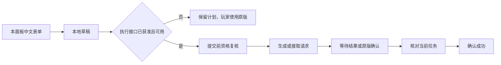

# 做货功能：公开接入途径与接口要求

调查日期：2026-11-03。当前面板基线：0.2.5。本轮只研究公开文档与公开 SDK 源码；没有开发或安装货运执行模块。

## 结论

“在当前 TMP 会话里选货、生成、到场直接接取”是原版已经具备的功能。第三方中文面板的运行记录也已说明技术上可实现这一流程。但截至本轮核对，本项目仍没有可用的、获准接入的货运调用合同。

这次确认了一个范围有限的官方入口：`/job-accept [id]` 可接受其他玩家通过原版调度器发送的任务邀请。它不提供任意城市、公司、货物和挂车参数，不等于通用创建任务接口。暂未找到公开的货运分享代码导入、调度器打开/预填或任意任务生成 API。

后续优先索取正式 SDK 扩展或经双方确认允许集成的第三方桥接合同。尚未取得确认时，可以完善任务读取和本地计划；执行仍由玩家在原版界面完成。不能把手动操作流程宣传为本面板已经支持一键做货。

## 本轮补齐的官方证据

| 来源 | 查到的能力 | 对实现的限制 |
| --- | --- | --- |
| [原版调度器说明，KB 1410](https://truckersmp.com/knowledge-base/article/1410) | 游戏内直接生成，无须读档；自有挂车、挂车预览、兼容货物/国家挂车规则、任务分享 | 这是玩家操作说明，没有第三方调用合同 |
| [命令与按键，KB 85](https://truckersmp.com/knowledge-base/article/85) | `/job-accept [id]`、`/job-decline [id]` 处理别人发来的任务邀请 | 文档没有将它们定义成创建任意货物任务的命令；不得编造邀请或假定 ID 是货物 ID |
| [Intents](https://docs.truckersmp.com/client-sdk/advanced/intents) | 公开 Bus 扩展、按项目申请的 Chat 扩展 | 没有列出货运扩展；存在申请机制不证明货运模块已经存在或一定会获批 |
| [Bus](https://docs.truckersmp.com/client-sdk/advanced/bus) | 当前公交任务、站点、乘客和任务事件 | 当前公开头文件没有创建或接受公交任务的操作，更不能将其当成货运创建接口 |
| [User Interface](https://docs.truckersmp.com/client-sdk/modules/user-interface) | `ShowNotification` 通知 | 不提供打开原版调度器、查找控件或填写表单的方法 |
| [Gameplay](https://docs.truckersmp.com/client-sdk/modules/gameplay) | 已挂载 TMP 内容包、无碰撞区进入/离开事件 | 不提供城市/公司货物目录；无碰撞区也包括车库、维修站，不能当作接货资格 |
| [公开 Web API 规格](https://docs.truckersmp.com/redocusaurus/web-api-v2.yaml) | 玩家、服务器、活动、VTC、游戏时间/版本/规则 | 本轮枚举的公开路径没有货运目录、生成或接取操作 |
| [SDK v1.1.0](https://github.com/TruckersMP/GameClientSDK/releases/tag/v1.1.0) 及 `master` 公开头文件 | 最新发布新增车辆和挂车包围盒；扩展由函数表提供 | 未发现货运模块。`GetRawApi` 是扩展包装器的接入口，不是允许猜测 API ID、破解权限或调用任意内部函数的承诺 |

GitHub latest 在本轮仍返回 v1.1.0，发布时间为 2026-08-28。文档页顶端的 1.0.0 宣传横幅不作为最新版本依据。

## 原版做货规则：现在可以明确哪些事情

官方 KB 1410 描述的流程为：TAB → 调度器图标 → 选择起终点城市/公司 → 货物 → 挂车/自有挂车 → 紧急程度 → 立即接取或导航至公司。

- 始发城市选择涉及玩家已发现的城市；不能直接拿一份全地图目录冒充当前可用始发地。
- 同城可能有多个同名公司，原版提供地图定位。因此选择键必须能区分地图中的货场实例，不能只用显示名称。
- “公司兼容货物”和“符合起终点国家规则的挂车”是原版可选筛选，不能把开启某筛选后的结果当成全部目录。
- 官方说明支持当前已连接的自有挂车。生成成功、任务已接受、挂车已连接、货物已装载仍是不同状态。
- 缺少 DLC 时，相应货物/挂车不会可用；复制别人使用自己未拥有 DLC 的挂车也有限制。
- 当前任务的分享隐私分为 Private、Steam Only、Public。复制其他玩家任务必须尊重其设置；不能以附近玩家列表存在该玩家为依据推定可复制。

**接取距离存在需要确认的差异。** 本轮读取的官方文章写“within 400 metres of the company”；此前本机第三方面板日志提示“550 米内”。这说明不能将日志文字直接当成跨版本规则，也不能仅凭文章断言当前所有客户端统一使用 400 米。实际执行适配器应提供资格状态和拒绝原因；在未获得该接口时，只显示附近货场距离，不显示“已允许接取”。

## 两条需要确认的正式集成路线

### A. 向 TMP 申请有文档的货运扩展

官方 Intents 的用途是按项目开放模块，而不是提供通用的客户端修改豁免。文档目前只明确列出 Bus 和 Chat，因此应先问“是否存在或愿意提供货运扩展”，不能先假定存在 Freight intent。

申请材料可以具体到以下能力：

1. 读取当前会话允许的城市、货场实例、货物及挂车目录。
2. 按草稿查询路线可用性、适用挂车、DLC/车辆/当前任务限制。
3. 查询指定起点公司当前能否接取，提供机器可读原因。
4. 请求生成货单或生成并立即接取，并获得请求状态/任务标识。
5. 在任务开始、取消、交付、切档和断线时提供失效通知。

Chat 权限只能按其实际合同使用。文档中“注册聊天命令”表示插件可以定义自己的命令，并不证明插件能执行任何原版命令；不能以此承诺自动发送 `/job-accept`。

私有 intent 包需要保持私有，不能提交到本公开仓库或转移给另一项目使用。若取得扩展，公开界面和业务模型应与私有适配模块分开；分发方式以官方给出的许可为准。绝不从其他插件提取其访问包或解锁信息。

### B. 由现有面板作者提供正式桥接接口

这条路线必须由作者主动提供接口及集成许可，并确认其获批范围覆盖这种外部调用。本轮没有联系作者或官方，也没有收到这类接口材料。

优先要求稳定的“目录、草稿、资格、请求、结果”接口，而不是调用地址、对象指针或“替用户点击原版按钮”。连接形式可以由作者选择，关键是明确线程要求、异步结果、支持版本、会话失效与错误处理。

已有插件可运行、玩家购买了使用权、作者声明获得审查，均不能单独代替我们的集成合同。作者不提供接口时，不把二进制提取或访问授权复用作为替代路线。

## 现在能够提供的有限流程

在不接入非公开接口的情况下，面板可用 SCS 遥测读取当前任务的货物、起终点公司、重量、市场、截止时间及装载状态，记录玩家在原版创建的任务，并将其保存为本地路线计划。这些是可实施设计，本轮尚未编写功能。

玩家仍自行打开原版调度器、选择货物并确认；面板不能显示一个没有后端的“打开原版调度器”或“立即接取”按钮。若已有别人发来的任务邀请，可向玩家展示官方接受/拒绝命令的使用说明；未取得可验证邀请数据和命令接口前，不自动提交指令。

从已接任务保存出的计划只证明“过去运过这一单”，不证明当前地图、DLC、服务器和货场仍允许生成。任务数据应保留稳定 ID、显示名和来源；不要解包或逆向 TMP 数据文件来补齐目录。

## 适配器合同草案

以下名称是本项目拟定的抽象能力，不是已经存在的 TMP API。

| 能力 | 必需输入/输出 | 失效处理 |
| --- | --- | --- |
| `Capabilities` | 提供者及版本、支持游戏/服务器/市场、支持操作、是否需读档 | 不支持的动作不显示为可执行 |
| `CatalogueSnapshot` | 会话代次、目录修订；城市/货场/货物/挂车稳定 ID；可用方向及状态 | 显示名不充当身份；切档/切服后旧 ID 需重新确认 |
| `EvaluateDraft` | 草稿快照、原版路线状态、兼容性、到场资格与原因 | 尚未计算和不允许分开，未知不视为允许 |
| `Submit` | 本地请求 ID、会话/目录版本、草稿、生成或立即接取意图 | 由玩家明确操作触发；提交前复核；不在渲染回调阻塞 |
| `OperationStatus` | 等待、拒绝、需要玩家确认、已生成、已接取、结果未知 | 发出请求不等于成功；超时先查询，不盲目重发 |
| `CurrentJob` / 事件 | 原版任务标识、稳定字段、生命周期信号 | 与操作结果对应后才宣布成功；同路线重复任务不能仅靠同名货物判断 |

每个结果必须携带产生它的会话代次和请求 ID。断线、重新连接、切档、目录替换或提供者重载后，旧结果不能覆盖新会话；不可把尚在 HTTP/IPC 队列里的旧请求重新发送到新服务器。

## 更新兼容性

[官方 SDK 版本政策](https://docs.truckersmp.com/client-sdk/concepts/versioning)称版本通常支持约一年，兼容窗口内可保持二进制运行；过旧或过新的版本协商会失败，退役操作还可能返回 `NotSupported`。这才是可依赖的版本合同，不能把它外推给非公开函数。

若使用作者桥接接口，其实现方式和维护责任必须明示。API 合同稳定不代表底层永远不变，仍需提供能力查询、版本范围和失效状态。界面应始终能降级为只读，不把执行失败变成整个面板失效。

## 本轮交付与下一步

- 已重新读取官方 SDK 最新发布及公开头文件、Intents/Gameplay/UI/Bus/Versioning 文档、Web API 规格、原版调度器及命令说明。
- 已补齐原版不读档、自有挂车、分享隐私、DLC 和任务邀请命令的官方依据，明确距离文档与现有运行日志的差异。
- 本项目尚未取得内部货运接口或其定位分析的进一步确认。研究继续限于公开资料、自己的模型与有文档的接入方案。
- 未启动游戏或第三方插件、生成任务、读取真实存档、操作游戏内存、分析 TMP/第三方二进制、编译、测试、烟测或 SHA 校验。没有发出工单或聊天消息。
- 当前运行代码与已安装版本保持 0.2.5。下一项真正解除“自绘面板里一键做货”障碍的工作，是取得 A 或 B 的明确接口合同；单独增加表单或运输统计无法代替它。

早期技术路线比较见 [深入研究](FREIGHT-DEEP-DIVE.md)。本轮公开资料的本机文本快照保存在 Git 忽略的 `build/freight-public-research-20261103/`。
