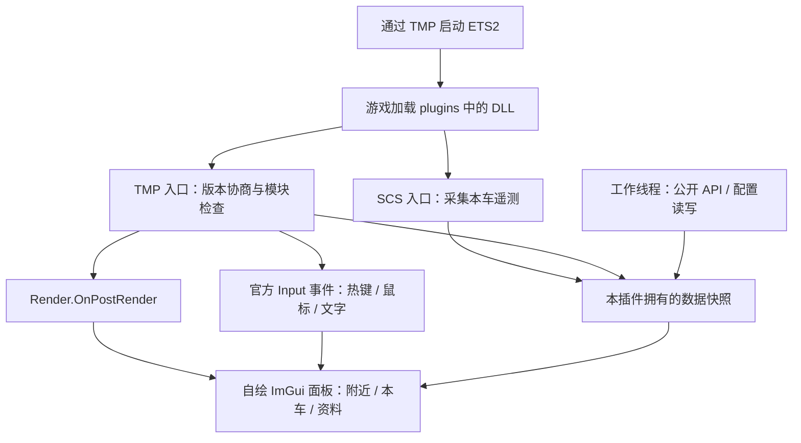

# 游戏进程内 DLL 面板：可行性与迁移方案

日期：2026-11-03。用户本轮选择：整个面板放进游戏画面，由 DLL 在游戏进程内绘制，随游戏启动。

这是实施前的设计记录。现有游戏内版本已在 `overlay/` 实现，最新修复状态和操作说明见 [overlay/README.md](../overlay/README.md)；下文的“本轮未实施”指当时的研究阶段。

本轮是探索与设计：核对源码、已安装文件记录和公开文档，未修改运行代码或游戏部署，未启动程序、加载新 DLL、编译、测试、烟测或进行 SHA 校验。

## 结论

可行，建议采用 **TruckersMP 官方 SDK 插件加载 + Dear ImGui 自绘界面 + D3D11 渲染**。交付一个含 SCS 和 TMP 入口的 `TruckCompanionOverlay.dll`，安装到游戏 `bin/win_x64/plugins`。正常运行时不需要独立面板 EXE、启动器或后台监控程序。

官方 Render 文档明确描述了获取 D3D11 设备、在 `OnPostRender` 中绘制，以及使用 Dear ImGui D3D11 后端并通过 Input 模块接收输入的模式。这能满足自绘完整游戏内面板的目标，同时不复用 TMP 的原生控件、资源包、字体或内部函数地址。

游戏负责加载插件。“自动启动”的准确时点是游戏加载插件、用户完成游戏自身的 SDK 提示确认、TMP 初始化插件后，在首个可用绘图回调中显示。不是启动 TMP 启动器时就出现，也不绕过游戏提示。



## 支持范围与取舍

| 路径 | 本次判断 |
| --- | --- |
| TMP + DirectX 11，由 SDK 加载并在游戏内绘制 | 推荐作为首版实现范围 |
| TMP + OpenGL | SDK 有对应渲染器标识，但设备值为 0；需要独立 OpenGL 后端，首版不承诺支持 |
| 普通 ETS2 单机，仅 SCS SDK | SCS 能自动加载 DLL 和提供遥测，但没有 TMP 的绘图/输入回调；不能据此承诺同一个游戏内面板可用 |
| DLL 自动拉起现有 EXE | 能实现随游戏启动，但不符合本轮选择的完整进程内绘制目标 |
| 外部注入器、代理 dxgi/dinput8、Present/SwapChain 挂钩 | 当前目标已有官方接口可用，不纳入新目标；也会重新引入此前要摆脱的挂钩与维护问题 |

界面进入游戏渲染流程后，不再依赖桌面置顶窗口覆盖游戏，通常更适合全屏显示；独占全屏、Alt+Tab、分辨率切换、HDR/截图捕获的实际表现仍需另行确认。

进程内绘图会失去独立 EXE 的故障隔离。UI、网络库或图形代码出现严重错误可能影响游戏进程；不能称为“零风险”“零性能开销”或“永久兼容”。

## 当前代码能复用什么

已安装的 `PanelDataBridge.dll` 是 SCS + TMP SDK 版本，其角色仍是只读采集；`TruckCompanionPanel.exe` 负责独立窗口。检查源码没有发现 DLL 自动启动 EXE 的逻辑。

| 当前模块 | 迁移处理 |
| --- | --- |
| `panel/collector.cpp` | 保留公开 SDK 数据来源、有效位、限频采样和 SCS 独立生命周期；拆出入口和采集服务 |
| `panel/protocol.h` | 提取与进程通信无关的数据模型，继续保留过期和缺失状态 |
| `panel/public_api.*` | 保留固定 HTTPS 主机、限频、缓存和字段校验；重做取消、发布快照和退出方式 |
| `panel/settings.*` | 复用账号、关注、字体/透明度偏好；游戏内位置改用视口相对位置，异步读写 |
| `panel/main.cpp` | 提取搜索、筛选、排序与资料展示逻辑，三页布局重写成 ImGui 组件 |
| `panel/canvas.h`、`dialogs.h` | HWND、D2D DC 和原生对话框属于外部窗口实现，不作为游戏内 UI 后端 |
| `panel/data_client.h`、`transport.*` | 新 DLL 不需要枚举进程或通过管道读取自己；保留在独立面板回退版本中 |
| 原速度仓库的 `src/sdk_plugin.cpp` / `src/panel.h` | 仅参考官方回调与渲染生命周期经验；文件未迁入本仓库，避免整包连带旧 MinHook、原生文字和内部地址适配逻辑 |

### 迁移前必须处理的源码问题

1. **SDK 句柄生命周期。** 当前采集池保存 `TruckersMP::Player` 句柄。官方 Architecture 文档要求句柄按当次事件/getter 取得，不跨生命周期保存使用。新模型应主要保留游戏内 ID、TMP 账号 ID 和会话代数；采样时通过 `GetPlayerByID()` 重新获取并核对身份，失效返回不发布。流出事件里的句柄只在回调内处理，无法取得身份时安排有界的成员刷新，不继续调用失效句柄。
2. **同步 HTTP 退出。** 当前 `PublicApi` 析构执行 `thread.join()`，HTTP 请求使用同步 WinHTTP。放进游戏插件后不能直接在关服/重载回调中等待它完成。应使用可取消请求、明确的停止状态和工作线程持有模块引用；新 Session 不能收到旧实例的异步结果。
3. **主线程等待。** 当前 DLL 的最后一次 `Release()` 最多等待两秒。这不能原样成为游戏内 UI 的常规关闭路径；关闭面板只改变显示/输入状态，真正卸载走独立清理流程。
4. **ImGui 状态恢复缺口。** 本机已有的 Dear ImGui 1.92.9 DX11 后端会清空 Hull、Domain、Compute shader，但现有恢复结构未保存这些状态。必须增加对应 shader/class instance 的保存恢复，并审计本目标额外修改的 RTV/DSV、视口、裁剪、混合及资源绑定。不能仅凭“使用官方 ImGui 后端”就断言不会影响游戏画面。
5. **文件 I/O 与锁。** 当前配置保存含目录检查、文件写入、Flush 和替换；公开 API 缓存通过 mutex 返回复制结果。新绘图回调应消费已准备的数据快照，使用非阻塞发布/读取；不在回调中同步写配置、请求 HTTP 或等待工作线程。

## 建议的新模块

```text
overlay/
  entry.cpp              SCS / TMP 导出与版本协商
  runtime.cpp            生命周期、会话代数、功能状态
  telemetry.cpp          本车与附近玩家采集
  model.h                自有数据模型、有效位与时效
  renderer_dx11.cpp      设备资源、帧绘制、状态恢复
  input.cpp              SDK 事件转 ImGui 输入、输入锁管理
  views.cpp              附近 / 本车 / 资料 / 设置
  api_worker.cpp         可取消的公开资料请求、缓存和结果队列
  settings_worker.cpp    自有配置加载、节流保存与迁移
  build.ps1              只编译链接，不调用旧构建链
```

为新目标单独固定 Dear ImGui 版本与许可证。首版关闭多视口功能，确保 UI 始终在游戏画面中，不额外创建独立顶层窗口。UI 字体使用有适当许可的字体资产或读取本机系统字体，不再从 TMP 资源覆盖目录取字体。

## 启动、绘图和更新兼容

1. `DllMain` 不做绘图、COM 初始化、网络、线程等待或复杂清理。逻辑入口放在官方 `scs_telemetry_init` / `truckersmp_init`；GPU 初始化延迟到有效的 Render 回调。
2. `Session::Create()` 协商版本，检查 Render、Input、Player、Vehicle 等所需模块。支持缺失时保留可用数据源并记录原因，禁止回退到内部地址扫描。
3. `OnPostRender` 内读取渲染器类型和官方设备句柄。DX11 获取有效 `ID3D11Device`、context、当前 render target 与 viewport；目标不可用就跳过本帧，不自行寻找或挂钩 swapchain。
4. 每个可见游戏帧绘制面板，数据采样仍限频；不能把“数据 10Hz 更新”误做成“每十帧才画一次”。隐藏时停止 UI 绘图，绘图回调不执行网络和磁盘 I/O。
5. 不跨帧持有 backbuffer/RTV；对最小化、设备变化、尺寸变化和设备移除分别处理。GPU 资源失效后在后续有效帧重建；不尝试修复游戏的设备。
6. 每次重载创建独立 runtime 与代数。卸载先停止输入与绘图回调，再释放资源；SCS 与 TMP 生命周期仍分别计数，不能一方结束就销毁另一方仍在使用的对象。

兼容依据从内部地址变为官方 SDK 的函数表契约。官方文档称 SDK 版本支持窗口约一年；超出支持窗口、重大接口变更或模块退役仍可能需要重新编译或适配。

## 输入与中文支持

保留 `Ctrl+Shift+V` 显示/隐藏、`Ctrl+Shift+E` 驾驶/编辑的习惯，但由 SDK `OnKey` 处理，只作用于游戏内，不再注册全局桌面热键。处理按下沿与修饰键，避免按住时反复切换。

- 驾驶态：显示信息，不请求鼠标、不拦截驾驶键。
- 编辑态：通过官方 Input 请求鼠标、管理游戏输入锁，将坐标、按键、滚轮转入 ImGui；对面板内鼠标按钮使用事件的 `SetBlock(true)`。
- 输入文本使用 `OnChar` 的 UTF-32 字符事件，不能用虚拟键值拼接中文。
- 鼠标引用增减严格配对。锁操作检查返回值，记录本实例成功取得的状态，关闭、异常、设备失效及 shutdown 都清理；与 TMP 自己页面同时开关时的锁所有权/竞争行为仍需确认。
- SDK 文档证明的是字符输入，不是完整中文 IME 合成、候选框位置和焦点行为。完整中文搜索需单独实现平台 IME 适配并实机确认，不能只接 `OnChar` 就宣称完成。

## 实施分期

| 阶段 | 具体产物 | 进入下一步的依据 |
| --- | --- | --- |
| 1. 最小 DLL HUD | 自动加载、自绘标题/本车速度、显示热键、关闭与重载清理 | 源码和编译成立；首帧 target/device 与实际呈现尚需允许后确认 |
| 2. 完整交互 UI | 三个页面、设置、中文文字、鼠标、搜索/关注/排序 | 输入锁和生命周期设计完整；IME、冲突和视觉行为保留实机验收 |
| 3. 资料与容量 | 取消型 HTTP、VTC、服务器、列表容量和过期状态 | 回调无等待网络/磁盘，旧会话结果不会污染新会话 |
| 4. 部署迁移 | 备份当前 `PanelDataBridge.dll` 后安装新 DLL，避免两个模式同时加载 | 文件部署和回退记录；保留现有 EXE 及 DLL 作为回退包 |

这里列的是后续开发路径，本轮没有实施这些代码变更。用户的禁止测试、烟测及 SHA 校验要求仍有效；未来即便完成编译，也必须继续区分“编译通过”和“游戏内已验收”。

## 尚未实证的部分

- 当前 TMP 版本的每次 `OnPostRender` 是否都有适合此 UI 的目标和视口。
- 不同画面模式下的呈现、Alt+Tab、设备重建、截图捕获，以及与其他图形插件的组合。
- 中文 IME、鼠标坐标缩放、输入锁与 TMP 聊天/TAB/Settings 的交互。
- 首次字体上传、大量玩家、重载及退出时的帧时间和资源释放。

官方文档支持此接入机制，不等于此前工单已经单独批准本项目及其具体显示内容。现有未发送的外部窗口方案工单草稿与本轮方案不同，若以后咨询，应明确改为 SDK Render/Input 自绘；本轮没有发送消息或工单。

## 依据

2026-11-03 通过 HTTPS 实时读取并核对：

1. [Render：设备、绘图回调、状态恢复、Dear ImGui](https://docs.truckersmp.com/client-sdk/modules/render)
2. [Input：文字、鼠标、阻止点击、输入锁](https://docs.truckersmp.com/client-sdk/modules/input)
3. [Getting Started：插件目录、启动提示、重载、SCS 共存](https://docs.truckersmp.com/client-sdk/getting-started)
4. [Architecture：生命周期、模块与句柄](https://docs.truckersmp.com/client-sdk/concepts/architecture)
5. [Versioning：握手与支持窗口](https://docs.truckersmp.com/client-sdk/concepts/versioning)
6. [Microsoft：DLL 初始化与 loader lock 约束](https://learn.microsoft.com/en-us/windows/win32/dlls/dynamic-link-library-best-practices)

同时核对本仓库 `vendor/tmp-sdk/include/TruckersMP/TruckersMP.hxx`、当前 `panel/` 源码、已安装 receipt，以及本机 `ETS2Trainer/cpp/vendor/imgui-1.92.9/backends/imgui_impl_dx11.cpp`。历史旧插件的存在仅作为源码参考，不代表它们当前仍在加载。
